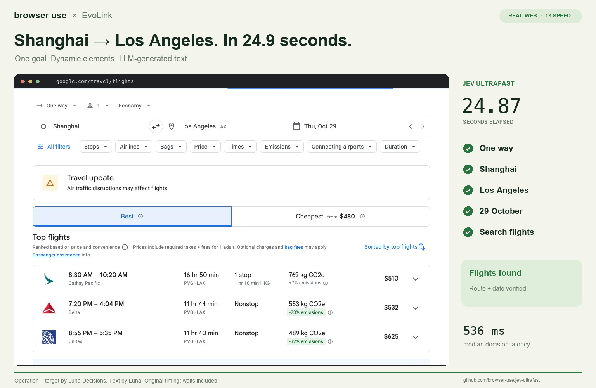

# Jev Ultrafast — EvoLink Luna

A small browser agent that turns a natural-language goal into observed browser actions using **EvoLink Luna Decisions**. A separate **Luna text model** generates search terms and field values when typing is needed.

This is an EvoLink adaptation of [browser-use/jev-ultrafast](https://github.com/browser-use/jev-ultrafast), published under the original [MIT license](LICENSE). Browser Use Cloud and the `browser-use` Python package are not required; browser control uses [Browser Harness](https://github.com/browser-use/browser-harness).

## What is it useful for?

- **Prototype browser workflows:** give the agent a narrow task, such as finding a page, entering search criteria or applying a filter.
- **Inspect model decisions:** the local inspector exposes numbered controls, operation probabilities, target probabilities, latency and action history. You can choose and execute one step at a time.
- **Evaluate a Decisions API integration:** compare model choices against actual browser outcomes rather than treating a valid response or `DONE` as success.
- **Build small acceptance tests:** supply your own completion check for a visible result, URL or applied filter.

It is an experimental baseline for developers. Multi-step tasks can stall, choose unsuitable text, or declare completion too early. It is not a booking service or a reliable general-purpose travel assistant.

## Recorded example

**Shanghai → Los Angeles, one-way, October 29, 2026, one adult, economy.** The final recorded attempt displayed matching flight options and passed independent checks.

[](docs/evolink/shanghai-lax.mp4)

[Watch the English MP4](docs/evolink/shanghai-lax.mp4) · [Measurements and limitations](docs/evolink/README.md) · [Run summary](docs/evolink/run-summary.json)

The logged agent time was **24.868 seconds**; the video is **25.6 seconds** at original speed, including loading waits and a final hold. The successful attempt made **26 decision requests + 4 text requests**, all HTTP 200. It used the optional completion guard described below. Four earlier live attempts failed; a later multi-month fare-calendar task also failed to finish automatically. These are individual development runs, not a reliability benchmark. The upstream 7.1-second Jev/Mercury result is not a Luna measurement.

## Quick start

You need **Python 3.12+**, [uv](https://docs.astral.sh/uv/), a local Chrome/Chromium browser and an [EvoLink API key](https://evolink.ai/). Node.js is only needed for the development syntax checks; FFmpeg and Pillow are only needed for rendering videos.

### 1. Install

```bash
git clone https://github.com/cheercheung/jev-ultrafast.git
cd jev-ultrafast
uv sync --frozen
cp .env.example .env
chmod 600 .env
```

### 2. Fill in your local key

Edit `.env` in your editor. Enter the **same EvoLink key in both key fields**. The remaining defaults already select Luna for both jobs:

```dotenv
DECISION_PROVIDER=evolink
EVOLINK_API_KEY=your_evolink_key
EVOLINK_BASE_URL=https://direct.evolink.ai
EVOLINK_MODEL=gpt-6-luna-decisions

TEXT_MODEL_API_KEY=your_evolink_key
TEXT_MODEL_BASE_URL=https://api.evolink.ai/v1
TEXT_MODEL=gpt-6-luna
TEXT_MODEL_REASONING=none
```

Use literal values in `.env`; the inspector's loader does not expand `${VARIABLE}` references. The file is ignored by Git. Keep real keys out of source files, screenshots and exported traces.

| Job | Endpoint | Model |
| --- | --- | --- |
| Choose the operation and observed target | `POST https://direct.evolink.ai/v1/decisions` | `gpt-6-luna-decisions` |
| Generate a field value for `TYPE_TEXT` | `POST https://api.evolink.ai/v1/chat/completions` | `gpt-6-luna` |

Decisions selects from supplied options; it does not write free-form field text. Do not use `gpt-6-luna-decisions` as the text-helper model. See [Decisions documentation](https://evolink.ai/docs/en/api-manual/language-series/gpt/decisions/decisions-reference.json) and [Luna Chat Completions](https://evolink.ai/gpt-6-luna).

### 3. Connect your browser

Use a **dedicated test browser profile**, then run:

```bash
uv run browser-harness --doctor
```

Follow [Browser Harness's connection instructions](https://github.com/browser-use/browser-harness/blob/main/install.md) to enable remote debugging for that browser. The default local connection uses an existing browser profile; creating an owned tab does not create a fresh profile. If you already manage an isolated CDP browser, set `BU_CDP_URL` or `BU_CDP_WS` to its endpoint.

### 4. Open the inspector

```bash
uv run --env-file .env jev
```

Open **http://127.0.0.1:8766**. Replace the prefilled upstream goal with your task, using a future date for any travel search. Click **Start demo**, then **Run automatically**.

For step-by-step inspection, use **Choose next → Execute choice**. The **Targets** toggle overlays element indices, and **Export trace** saves the executed history. The inspector retains the upstream visual layout; the provider and models are selected by `.env`.

The inspector does not install a task-specific completion check automatically. Inspect the final page yourself, or use the Python API below to make completion depend on an independent check. Live runs make paid model requests; the offline tests do not.

### Common setup issues

- **Browser not connected:** run `uv run browser-harness --doctor` and complete the connection for your test browser. For local CDP, ensure `localhost` and `127.0.0.1` bypass any proxy.
- **Missing `socksio`:** an inherited `all_proxy=socks5://...` requires HTTPX's optional SOCKS dependency. If working HTTP(S) proxy settings are already available, use `env -u ALL_PROXY -u all_proxy uv run --env-file .env jev` to omit only the SOCKS fallback for that process. Otherwise configure the required proxy support first.
- **No text generated:** fill `TEXT_MODEL_API_KEY` as well as `EVOLINK_API_KEY`; they can contain the same key. A Decisions key alone does not populate the text-helper setting.
- **Repeated actions or early completion:** narrow the goal, inspect the trace and add an independent completion check. Do not count a stopped loop as a successful search.

## Run your own task

The CLI accepts a starting URL and one natural-language goal:

```bash
uv run --env-file .env python examples/run.py \
  --url https://en.wikipedia.org/wiki/Main_Page \
  --goal 'Find and open the English Wikipedia article about Ada Lovelace.'
```

For an acceptance test, save the following as `your_task.py`. The checker only verifies the observed result; it does not choose or execute browser actions.

```python
from urllib.parse import urlparse

from jev_ultrafast import Agent


def article_is_open(page):
    url = urlparse(page["url"])
    return url.hostname == "en.wikipedia.org" and url.path == "/wiki/Ada_Lovelace"


with Agent(
    "https://en.wikipedia.org/wiki/Main_Page",
    "Find and open the English Wikipedia article about Ada Lovelace.",
    completion_check=article_is_open,
) as agent:
    for state in agent.run():
        print(state["elapsed_ms"], state["status"])
    if not article_is_open(agent.snapshot()["page"]):
        raise RuntimeError("The requested article was not opened")
```

```bash
uv run --env-file .env python your_task.py
```

`completion_check` removes `DONE` from the offered operations until the observed page passes the callback. You still need a meaningful checker and a final assertion: `BLOCKED`, an exception or a call-budget stop is not success. The default budget is 60 executed actions and 120 decision attempts, with text calls additional.

## How the loop works

```text
page → visible text + indexed controls → Luna Decisions → operation + target
                                                               ↓
                                            TYPE_TEXT? → Luna → field text
                                                               ↓
                                   validate freshness → execute → observe
```

Available operations are `CLICK`, `TYPE_TEXT`, `SELECT`, `SCROLL_UP`, `SCROLL_DOWN`, `WAIT`, `DONE` and `BLOCKED`. The operation and operation-specific target questions share one Decisions request. Only the target matching the chosen operation can execute. A target with one observed choice is resolved locally because the API requires at least two choices; its probability of 1 is deterministic, not a model confidence estimate.

The model sees structured page observations, not screenshots. It cannot return selectors or executable code. Execution checks page freshness and target occlusion. The agent logs each browser mutation before reading its result and does not replay uncertain browser mutations.

## What has actually been verified?

| Check | Result |
| --- | --- |
| EvoLink request/response mapping, malformed replies and target validation | Covered by offline tests |
| Single-day Shanghai → LAX search | Final attempt independently verified; earlier failures retained in the summary |
| Two-month fare-calendar comparison | Not completed by the agent; later manual/browser research is not an agent success |
| General reliability, price accuracy, model quality or total dollar cost | Not established |

The DOM reader supports common HTML and ARIA controls. Shadow roots, frames, canvas, uploads, pop-up tabs, nested scrolling and arbitrary keyboard widgets remain outside this MVP. The agent can cycle through controls without useful progress before reaching its budget.

Visible page text and controls are sent to the configured model endpoints. Use test data and a dedicated browser profile. A `DONE` prediction or HTTP 200 alone is never proof of the task's final outcome.

## Development

```bash
uv run ruff check .
BROWSER_HARNESS_HOME="$PWD/artifacts/offline-harness" uv run pytest -q
node --check jev_ultrafast/static/app.js
node --check jev_ultrafast/snapshot.js
uv build
```

The last verified offline run passed **50 tests**. Tests use mocked HTTP responses and do not require API keys or a browser. [Integration notes](EVOLINK_LOCAL.md) describe the wire mapping and verification boundaries.

| File | Purpose |
| --- | --- |
| [agent.py](jev_ultrafast/agent.py) | Goal loop, text handoff and optional completion check |
| [luna_decisions.py](jev_ultrafast/luna_decisions.py) | EvoLink Decisions transport mapping and response validation |
| [model.py](jev_ultrafast/model.py) | Dynamic operation/target questions and text generation |
| [browser.py](jev_ultrafast/browser.py) | Browser connection, freshness checks and execution |
| [snapshot.js](jev_ultrafast/snapshot.js) | Atomic DOM observations and indexed controls |
| [demo.py](jev_ultrafast/demo.py) | Loopback-only inspector |

## Upstream and license

Original project: [browser-use/jev-ultrafast](https://github.com/browser-use/jev-ultrafast), snapshot `1231850a0bf1a0c0341fe408ef1668dbbfdfac46`. Original authorship and the [MIT license](LICENSE) are preserved. This fork is maintained by [cheercheung](https://github.com/cheercheung); it is not an official Browser Use release.

The original TypeSafe transport remains available with `DECISION_PROVIDER=typesafe`, `TYPESAFE_API_KEY` and `TYPESAFE_MODEL`. Its separate text-helper configuration still applies. [Upstream measurements](docs/performance.md), [original demo](docs/demo.mp4) and [source provenance](EVOLINK_SOURCE.json) are retained for reference; their timings are not claims about EvoLink Luna.
